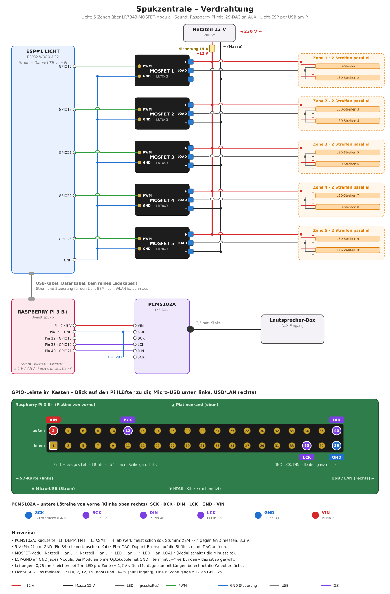

# 🎃 Spukzentrale

Halloween-Effektbeleuchtung mit Sound für ein Baugerüst-Netz. LED-Streifen unten an der Hauswand
strahlen auf ein dichtes weißes Gerüstnetz, Pappfiguren dazwischen werfen Schatten. Ein
unheimlicher Soundtrack läuft dauerhaft, zufällig kommen Donner, Hexengelächter und Schreie
dazu – jeweils mit passendem Licht, das genau auf dem Ton sitzt.

```
Handy ──► SERVER (Docker)  Weboberfläche, Szenen, Zufallsereignisse, Zeitplan,
            │               Ambiente-Stream, Home Assistant, MQTT
            │ WebSocket (JSON)                    │ HTTP (MP3-Stream, Effekt-Dateien)
            ▼                                     ▼
        ESP#1 LICHT                           ESP#2 SOUND
        5 PWM-Zonen, Effekte 100×/s           MP3-Stream + Effekte aus dem Flash
        läuft auch ohne Server weiter         Mixer → I2S-DAC → AUX der Box
            ▲            UART (Kabel)             │
            └─────────────────────────────────────┘
              Licht-Aktionen + Lautstärke-Hüllkurve, synchron zum Ton
```

## Inhalt

- [Funktionen](#funktionen)
- [Teileliste](#teileliste)
- [Verkabelung](#verkabelung)
- [Montage am Gerüst](#montage-am-gerüst)
- [Firmware flashen](#firmware-flashen)
- [Server in Portainer einrichten](#server-in-portainer-einrichten)
- [Bedienung](#bedienung)
- [Home Assistant](#home-assistant)
- [Fehlersuche](#fehlersuche)
- [Entwicklung](#entwicklung)

## Funktionen

- **Ambiente:** Playlist als Endlos-Stream mit Überblendung – keine Lücken beim Wiederholen.
- **Effekt-Sounds** (Donner, Schrei, Lachen, Herz, Wind, Kette, Kettensäge, Stimme, Sonstiges) liegen im Flash des
  Sound-ESP und starten sofort. Jeder Sound hat eine Licht-Aktion, z. B. *Blitze zum Sound*:
  jeder Knall im Donner wird ein Blitz.
- **Szenen** auf einer Zeitleiste: Gewitterfront, Schreck, Geisterwanderung, Herzschlag,
  Hexenauftritt, Kettensäge, Begrüßung – und eigene.
- **Zufallsereignisse** nach Regeln (z. B. „Donner alle 1–4 Minuten“), mit Mindestabstand.
- **Gruselstufen** 1 (Kinder) bis 3 (Schreck), auf Wunsch automatisch nach Uhrzeit.
- **Stimmungen:** 14 Licht-Effekte pro Zone (Kerze, Feuer, Geist wandert, kaputte Röhre …),
  als Favoriten speicherbar.
- **Zeitplan** ab Sonnenuntergang oder Uhrzeit, **Ruhezeit** (leiser oder nur Licht).
- **Auslöser:** Klingel gedrückt → Schrei mit Schreck-Licht, Person erkannt → Kettensäge –
  beliebige Sensoren aus Home Assistant (z. B. Reolink-Klingel), je mit eigener Sperrzeit.
- **Home Assistant** über MQTT-Discovery und REST-API.
- **Live-Vorschau** des Netzes in der Oberfläche – auch tagsüber einstellbar.
- **Montageplan:** Aufbau eintragen, die Oberfläche rechnet Abstände, Kabellängen und Strom aus.
- Licht-ESP läuft mit dem letzten Zustand weiter, wenn der Server weg ist.

## Teileliste

| Teil | Anzahl | Hinweis |
|---|---|---|
| ESP32-Board (ESP32-WROOM-32, 4 MB Flash, z. B. diymore NodeMCU) | 2 | einer Licht, einer Sound |
| MOSFET-Modul LR7843 (PWM-Eingang) | 5 | je Zone eins (6 für eine 6. Zone) |
| 12-V-LED-Streifen, einfarbig (z. B. COB) | 10 m | z. B. 10 Stücke à 1 m, je 2 pro Zone |
| Netzteil 12 V, 200 W | 1 | Reserve: 10 m COB ≈ 80–150 W |
| I2S-DAC PCM5102A (Modul mit 3,5-mm-Buchse) | 1 | Ausgang an den AUX der Box |
| Lautsprecher/Box mit AUX-Eingang | 1 | |
| USB-Netzteile für die ESPs | 2 | oder Step-Down 12 → 5 V |
| Flachsicherung 15 A + Halter | 1 | direkt hinter dem Netzteil |
| Flachsicherung 3 A + Halter | 5 | optional, je Zone |
| Litze 2 × 0,75 mm² | ca. 15 m | Zuleitungen und Brücken (genaue Länge: Montageplan in der Oberfläche) |
| Dupont-Kabel, Klinkenkabel | | |
| Gehäuse IP65 mit Kabelverschraubungen | 1 | für Elektronik und MOSFETs |

## Verkabelung



*(Der Plan wird mit `python3 docs/schaltplan.py` erzeugt – Pins und Zonenzahl stehen oben im Skript.)*

**MOSFET-Modul (LR7843, drei Schraubklemmen + zwei Lötpunkte):**

| Anschluss | kommt an |
|---|---|
| `+` | Netzteil +12 V (über die 15-A-Sicherung) **und** + der LED-Streifen der Zone |
| `LOAD` | − der LED-Streifen der Zone (das Modul schaltet die Minusseite) |
| `−` | Netzteil − (Masse) |
| `PWM` | GPIO des Licht-ESP (18, 19, 21, 22, 23) |
| `GND` | GND des Licht-ESP |

- **Gemeinsame Masse:** ESP-GND an GND jedes Moduls und GND zwischen den beiden ESPs – sonst
  funktionieren weder PWM noch UART. Bei Modulen ohne Optokoppler ist GND intern mit `−`
  verbunden, das ist so gewollt.
- **PCM5102A-Lötbrücken** (Rückseite): FLT, DEMP, FMT auf **L**, XSMT auf **H** (sonst bleibt er
  stumm). SCK an GND – der DAC erzeugt den Takt dann selbst.
- **Pins meiden:** GPIO 0, 2, 12, 15 (Boot) und 34–39 (nur Eingang).
- Eine 6. Zone ist möglich (z. B. GPIO 25 am Licht-ESP): `ZONEN_PINS` in `config.h` und die
  Zonenzahl unter *Einstellungen → Licht* anpassen.
- Brummt es über AUX (Masseschleife), hilft ein Entstörfilter für Klinke.

## Montage am Gerüst

Die LED-Streifen hängen **senkrecht an der Hauswand**, gleichmäßig verteilt (z. B. 10 Streifen
à 1 m im Abstand von 50 cm auf 5 m Wand) und leuchten auf das Netz davor. Je zwei benachbarte
Streifen bilden eine Zone. Pappfiguren zwischen Wand und Netz werfen Schatten.

**Montageplan in der Weboberfläche:** *Einstellungen → Aufbau & Montageplan*. Dort Wandbreite,
Anzahl und Länge der Streifen, Position des Kastens, Einspeisung (oben/unten), LED-Leistung und
Kabelquerschnitt eintragen und festlegen, welcher Streifen an welcher Zone hängt. Die
Oberfläche zeichnet daraus den Plan mit Abständen und berechnet je Zone Kabellänge, Strom,
Spannungsabfall und die Auslastung des Netzteils. Die Live-Vorschau zeigt die Streifen an
denselben Positionen.

- Die Streifen einer Zone hängen **parallel**: Zuleitung vom Kasten zum ersten Streifen, von
  dort eine kurze Brücke zum nächsten (+ an +, − an −).
- Zone 1 links, Zone 5 rechts (von vorne gesehen) – dann laufen Welle und Lauflicht in die
  richtige Richtung.
- Den Kasten möglichst **in die Mitte** setzen, dann bleiben die Zuleitungen kurz.
- **Figuren** 10–20 cm hinter dem Netz: je näher am Netz, desto schärfer der Schatten; je näher
  am Licht, desto größer. Dicken schwarzen Karton nehmen, dünne Pappe scheint durch. An Angelschnur
  aufgehängt bewegt der Wind sie – die Schatten leben.
- Offene Streifenenden mit Schrumpfschlauch oder Silikon abdecken. Nicht wetterfeste Streifen
  (IP20) vor Regen schützen, Netzteil ins Trockene.

## Firmware flashen

Voraussetzung: [PlatformIO](https://platformio.org/install/cli) (z. B. `pipx install platformio`).

```bash
git clone https://github.com/xNoVoSx/spukzentrale.git
cd spukzentrale/firmware

# Konfiguration anlegen und anpassen (WLAN, IP des Servers)
cp licht/include/config.example.h licht/include/config.h
cp sound/include/config.example.h sound/include/config.h
nano licht/include/config.h
nano sound/include/config.h

# Licht-ESP per USB anschließen und flashen
pio run -d licht -t upload
pio device monitor -d licht        # zeigt IP-Adresse und Status

# Sound-ESP per USB anschließen und flashen
pio run -d sound -t upload
pio device monitor -d sound
```

Spätere Updates gehen bei beiden ESPs per WLAN (in `config.h` steht dafür `OTA_PASSWORT`):

```bash
SPUK_LICHT_IP=<IP des Licht-ESP> SPUK_OTA_PASSWORT=<OTA_PASSWORT> pio run -d licht -e licht_ota -t upload
SPUK_SOUND_IP=<IP des Sound-ESP> SPUK_OTA_PASSWORT=<OTA_PASSWORT> pio run -d sound -e sound_ota -t upload
```

(In der fish-Shell: `env SPUK_LICHT_IP=… SPUK_OTA_PASSWORT=… pio run …`)

Beim Update holt sich der ESP die Firmware über TCP-Port **14933** vom PC ab. Läuft auf dem PC eine Firewall
(z. B. ufw), diesen Port für die ESPs freigeben: `sudo ufw allow from <IP des ESP> to any port 14933 proto tcp`.

Die Effekt-Sounds lädt der Sound-ESP selbst vom Server – dafür ist kein extra Upload nötig.

Die Treiber für den USB-Seriell-Chip CH340 sind unter Linux im Kernel enthalten.

## Server in Portainer einrichten

Das Docker-Image baut GitHub Actions bei jedem Push und legt es unter
`ghcr.io/xnovosx/spukzentrale` ab.

1. **Ordner auf dem Docker-Host anlegen**, z. B.
   ```bash
   sudo mkdir -p /docker/spukzentrale
   ```
   Für die Medien kann auch eine NAS-Freigabe genutzt werden (muss auf dem Docker-Host
   eingebunden und beschreibbar sein).
2. **Portainer → Stacks → Add stack → Repository**
   - Repository URL: `https://github.com/xNoVoSx/spukzentrale`
   - Repository reference: `refs/heads/main`
   - Compose path: `docker-compose.yml`
   - optional *GitOps updates* mit *Re-pull image* aktivieren
3. **Environment variables** (alle optional):

   | Variable | Bedeutung | Standard |
   |---|---|---|
   | `SPUK_CONFIG_PFAD` | Einstellungen, Szenen, Playlist | `/docker/spukzentrale` |
   | `SPUK_MEDIEN_PFAD` | Musik und Effekt-Sounds | `/docker/spukzentrale/medien` |
   | `SPUK_PORT` | Port der Weboberfläche | `8095` |
   | `SPUK_TAG` | Image-Version (`latest` oder z. B. `1.0.0`) | `latest` |
   | `TZ` | Zeitzone | `Europe/Berlin` |

4. **Deploy the stack**, dann `http://<IP des Docker-Hosts>:8095` im Handy öffnen. Tipp: „Zum
   Startbildschirm hinzufügen“ – dann startet die Oberfläche wie eine App.

Die Weboberfläche hat keine Anmeldung – sie gehört ins Heimnetz, nicht ins Internet.

## Bedienung

| Seite | Was |
|---|---|
| 🎃 **Show** | Live-Vorschau, Show an/aus, Ambiente, Zufallsereignisse, Gruselstufe, Helligkeit, Lautstärke, Sounds/Licht/Szenen auslösen, Stimmungen, Protokoll |
| 💡 **Licht** | Effekt, Tempo, Stärke und Grundlicht je Zone, „auf alle“, Zonen-Test, Stimmungen speichern |
| 🔊 **Sounds** | Ambiente-Playlist (Reihenfolge, Zufall, Überblendung), Effekt-Sounds hochladen, Licht je Sound einstellen, Speicherbelegung |
| 🎬 **Szenen** | Szenen-Editor (Zeitleiste) und Regeln für die Zufallsereignisse |
| ⚙️ **Einstellungen** | Auslöser, Zeitplan, Ruhezeit, Gruselstufe nach Uhrzeit, Home Assistant, MQTT, Standort, Ton, Licht, Aufbau & Montageplan, Geräte |

**Ersteinrichtung**

1. *Einstellungen → Licht → Zonen-Test*: Prüfen, ob Zone 1–5 an der richtigen Stelle hängen.
2. *Sounds*: Ambiente-Musik und Effekte hochladen (jedes gängige Format). Kostenlose Sounds:
   [freesound.org](https://freesound.org) (Filter: CC0), [pixabay.com/sound-effects](https://pixabay.com/sound-effects/).
3. *Einstellungen → Ton → Ton-Licht-Abgleich*: draußen „Klick + Blitz“ drücken und die Latenz
   so einstellen, dass Klick und Blitz zusammenfallen (mit DAC meist 40–80 ms).
4. *Einstellungen → Standort* für den Sonnenuntergang setzen, *Zeitplan* aktivieren.

**Sicherheit:** Das Stroboskop ist standardmäßig auf 3 Hz begrenzt. Schnellere Blitzfolgen
können bei Menschen mit Fotosensibilität Anfälle auslösen.

## Home Assistant

### Auslöser (Klingel, Personenerkennung)

1. In Home Assistant ein Langzeit-Zugriffstoken anlegen (*Profil → Sicherheit*).
2. *Einstellungen → Home Assistant*: Adresse (`http://<IP>:8123`) und Token eintragen.
3. *Einstellungen → Auslöser*: „Sensoren aus Home Assistant laden“ und je Auslöser den Sensor
   wählen. Bei der Reolink-Klingel:
   - `binary_sensor.<name>_visitor` – **Klingel gedrückt** → Szene „Schreck“ (Schrei + Licht)
   - `binary_sensor.<name>_person` – **Person erkannt** → Szene „Kettensäge“
4. Je Auslöser: Szene oder zufälliger Sound einer Kategorie, Sperrzeit, ab welcher Gruselstufe,
   nur wenn die Show läuft. „Jetzt testen“ löst sofort aus (ohne Sperrzeit).

Die Spukzentrale beobachtet die Sensoren über die WebSocket-API – in Home Assistant ist keine
Automation nötig. Tipp: In der Reolink-App eine Erkennungszone nur für den eigenen Weg anlegen.

### MQTT

*Einstellungen → MQTT*: Broker eintragen und aktivieren. In Home Assistant erscheint
automatisch das Gerät **Spukzentrale** mit Schaltern (Show, Ambiente, Zufallsereignisse),
Helligkeit, Lautstärke, Gruselstufe, Stimmung, einem Knopf pro Szene und dem Gerätestatus.

### REST-API

Alle Funktionen sind per HTTP erreichbar, Dokumentation unter `http://<server>:8095/docs`.
Beispiele:

```yaml
# configuration.yaml
rest_command:
  spuk_schreck:
    url: http://<server>:8095/api/szenen/schreck/start
    method: POST
  spuk_klingel:     # wie der Sensor: mit Sperrzeit und Gruselstufe
    url: http://<server>:8095/api/ausloeser/klingel
    method: POST
```

## Fehlersuche

| Problem | Ursache / Lösung |
|---|---|
| ESP startet neu / hängt | *Einstellungen → Geräte*: Startgrund (Absturz, Watchdog, Unterspannung), WLAN-Trennungen und Hänger stehen dort; ungewöhnliche Neustarts auch im Protokoll. Unterspannung: Netzteil/USB-Kabel prüfen. Viele WLAN-Trennungen: ESP näher an den Access Point. |
| Punkt „Licht“/„Sound“ oben ist rot | ESP nicht verbunden. Seriellen Monitor öffnen (`pio device monitor -d licht`): WLAN-Daten und `SERVER_HOST`/`SERVER_PORT` in `config.h` prüfen. |
| Keine Live-Vorschau | Licht-ESP offline (siehe oben). |
| „kein Signal vom Sound-ESP“ bei *Geräte* | UART-Kabel prüfen: TX ↔ RX gekreuzt? GND verbunden? |
| Licht kommt vor/nach dem Ton | *Einstellungen → Ton → Latenz* mit dem Ton-Licht-Abgleich einstellen. |
| Kein Ton | DAC-Verkabelung und Lötbrücken (XSMT auf H!) prüfen, AUX-Eingang an der Box wählen, *Geräte*: läuft der Stream, wie voll ist der Puffer? |
| Ton stottert, „Aussetzer“ zählen hoch | WLAN-Empfang am Sound-ESP zu schwach (RSSI unter −75 dBm) – näher an den Access Point oder externe Antenne. |
| Zone flackert dunkel / leuchtet nicht ganz aus | Modul schaltet nicht sauber: `PWM_FREQUENZ` in `config.h` senken (z. B. 500). PWM/GND richtig gesteckt? Montageplan: Spannungsabfall zu hoch? |
| Ganze Zone falsch herum (an = aus) | `PWM_INVERTIERT 1` in `config.h`. |
| Effekt-Upload: „Speicher voll“ | Der Sound-ESP hat ca. 1,2 MB ≈ 2 Minuten Effekte. Lange Sounds kürzen oder löschen. |
| Auslöser reagiert nicht | *Einstellungen → Auslöser*: Status „verbunden“? Auslöser aktiv und gespeichert? Sperrzeit, Gruselstufe und „Nur wenn die Show läuft“ beachten. „Jetzt testen“ prüft Sound und Licht. Server-Log in Portainer ansehen. |
| Server-Log | Portainer → Container `spukzentrale` → Logs. Mehr Details: Umgebungsvariable `SPUK_LOGLEVEL=DEBUG`. |

## Entwicklung

```bash
# Server lokal starten (braucht ffmpeg)
cd server
python3.12 -m venv .venv && . .venv/bin/activate
pip install -r requirements-dev.txt
SPUK_CONFIG=./data/config SPUK_MEDIEN=./data/medien uvicorn app.main:app --port 8095 --reload

# Simulierte ESPs verbinden (Licht + Sound, ohne Hardware)
python werkzeuge/sim_geraete.py --server http://localhost:8095

# Tests
python -m pytest -q
bash ../firmware/licht/test/effekte_test.sh
bash ../firmware/sound/test/adpcm_test.sh
bash ../firmware/sound/test/chunked_test.sh
```

### Aufbau

| Pfad | Inhalt |
|---|---|
| `firmware/common/protokoll.h` | UART-Protokoll zwischen den ESPs (`A5 5A typ len payload xor`) |
| `firmware/licht/` | Licht-ESP: Effekt-Engine (`effekte.cpp`), WLAN, WebSocket, PWM, OTA |
| `firmware/sound/` | Sound-ESP: Audio-Pipeline (`audio.cpp`), ADPCM-Dekoder, HTTP-Chunk-Dekoder |
| `server/app/` | FastAPI-Server: `zentrale.py` (Zustand), `ambiente.py` (Stream), `ablauf.py` (Szenen), `ereignisse.py`, `zeitplan.py`, `homeassistant.py`, `mqtt.py`, `licht.py` (Licht-Ausgang) |
| `server/static/` | Weboberfläche (Vanilla-JS) |

### WebSocket-Protokoll (Server ↔ ESPs)

Die ESPs verbinden sich mit `/ws/geraet?rolle=licht|sound&fw=<version>` und schicken
`{"t":"hallo",…}`, danach alle 2 s `{"t":"status",…}`.

| Richtung | Nachricht |
|---|---|
| Server → Licht | `config` {strobo_max_hz, gamma, zone_max[]}, `zustand` {an, hell, musik_reaktiv, zonen[{e, tempo, staerke, basis}], temp?}, `aktion` {name, zonen[], verz_ms, dauer_ms, staerke, param}, `stopp`, `vorschau` {an}, `neustart` |
| Licht → Server | `hallo`, `status`, `werte` {v[]} (10×/s, solange die Oberfläche offen ist) |
| Server → Sound | `config` {master, musik_vol, fx_vol, duck, latenz_ms}, `musik` {aktion: play\|stop, pfad}, `fx` {id, vol, licht?}, `fx_stop`, `fx_sync` {basis, liste[{id, groesse}]}, `neustart` |
| Sound → Server | `hallo`, `status`, `fx_fehlt` {id}, `fx_sync_fertig` {geladen, geloescht, fehler, meldung} |

Hat ein Effekt ein `licht`-Feld, schickt der Sound-ESP die Aktion im selben Moment, in dem
der Ton startet, per UART an den Licht-ESP (verzögert um die Ausgabe-Latenz). Ohne
UART-Verbindung schickt der Server die Aktion selbst.

## Lizenz

GPL-3.0 (wegen der verwendeten Bibliothek [arduino-libhelix](https://github.com/pschatzmann/arduino-libhelix)).
Schrift „Creepster“: SIL Open Font License, siehe `server/static/schrift/OFL.txt`.
